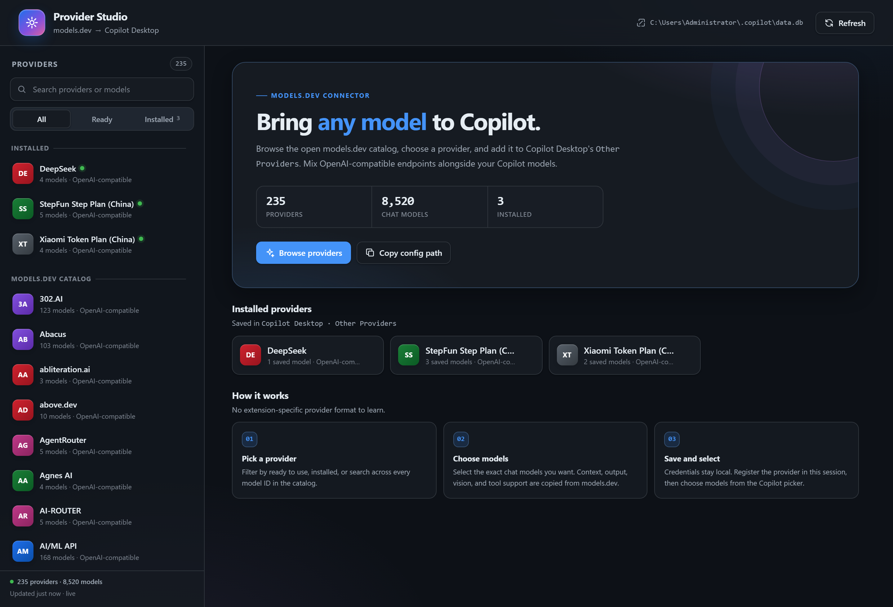
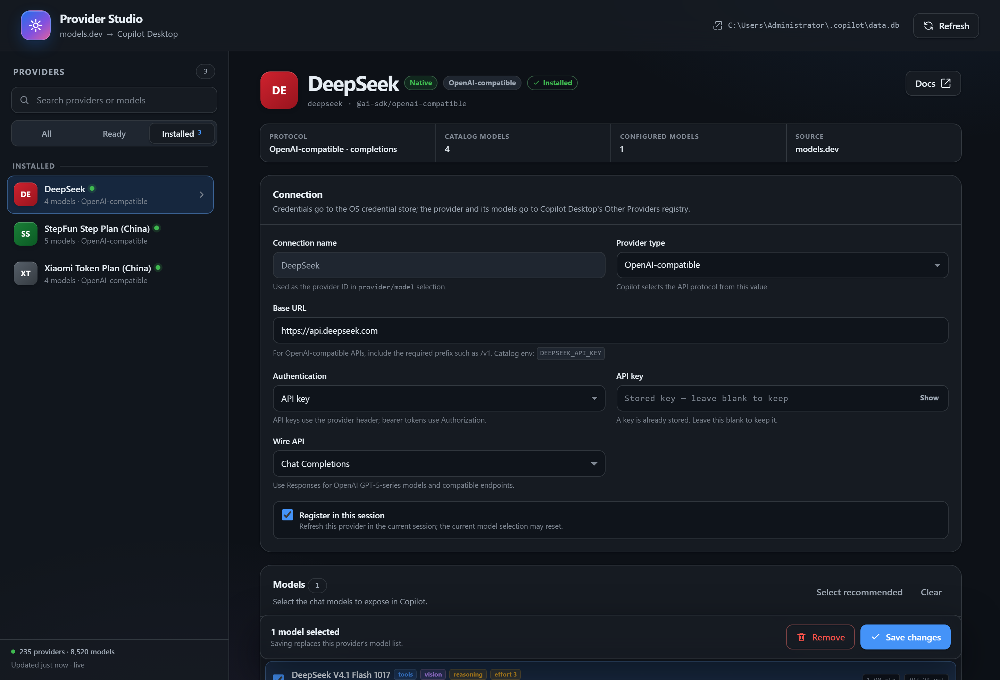
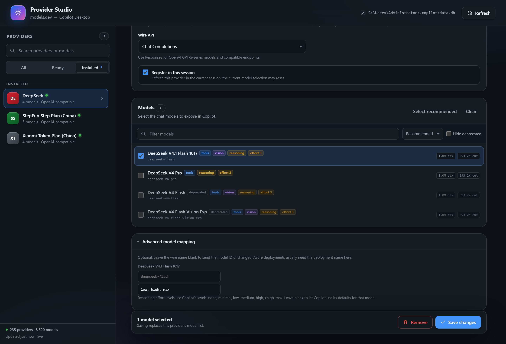

# Models.dev Providers for Copilot Desktop

[](LICENSE)

A canvas extension that connects [models.dev](https://models.dev) to **Copilot Desktop → Other Providers**.

Browse the open model catalog, pick a provider and its chat models, enter a key, and the provider is written into Copilot Desktop's own provider registry under the same place the *Other Providers* settings use. It is then available to every session, with reasoning-effort levels.

[中文说明](README.zh.md)



## Features

- Browse, search, and filter **hundreds of providers and thousands of chat models** from models.dev.
- Writes providers and models into Copilot Desktop's own provider registry, so they appear under **Other Providers** everywhere.
- Stores API keys and bearer tokens in the OS credential store, not in a plain-text file.
- Maps models.dev metadata into registry rows:
  - prompt and output token limits
  - tool-calling and vision support
  - reasoning-effort levels, which make Copilot's reasoning-effort control appear
- Edit or remove existing app providers from the canvas, including their model list and effort levels.
- Optionally registers the provider in the current session immediately.
- Credentials are never returned to the canvas UI or to the agent.

## Requirements

- GitHub Copilot Desktop with canvas extension support
- Network access to `https://models.dev/api.json` for the catalog
- Node.js 20 or later for development and tests

## Install

```bash
npm run install:extension
```

This copies the extension to `$COPILOT_HOME/extensions/models-dev-providers`, or to `~/.copilot/extensions/models-dev-providers` when `COPILOT_HOME` is not set. Start a new Copilot session afterward. You can also copy the folder manually:

```powershell
Copy-Item -Recurse extensions\models-dev-providers "$HOME\.copilot\extensions\models-dev-providers"
```

## Usage

1. Open the **Models.dev Providers** canvas.
2. Pick a provider from the sidebar or search for a model.
3. Select the chat models to expose.
4. Fill in:
   - **Provider name** — the display name shown in Copilot Desktop.
   - **Base URL** — the provider's HTTP(S) endpoint.
   - **Authentication** — API key, bearer token, or none.
   - **Wire API** — Chat Completions or Responses.
5. Leave **Register in this session** checked to use it right away.
6. Select **Add provider**, then pick the model in Copilot's model picker.



### Updating and removing

Select an installed provider to change its credentials or model selection. Unchecking a model removes it when you save. Removing a provider deletes its rows and its stored credential.

## Reasoning effort

Copilot Desktop shows its reasoning-effort control when a model row has a level list in `provider_models.supported_reasoning_efforts`, for example:

```json
["low", "medium", "high"]
```



- Levels come from models.dev `reasoning_options` when the catalog publishes an `effort` option.
- Models that only publish a reasoning toggle default to `["low", "medium", "high"]`.
- Levels can be edited per model in **Advanced model mapping**.
- Copilot recognizes `none`, `minimal`, `low`, `medium`, `high`, `xhigh`, and `max`. Only list levels your model actually accepts.

## Where data is stored

| Data | Location |
|---|---|
| Providers and models | `~/.copilot/data.db` → `model_providers`, `provider_models` |
| API key / bearer token | OS credential store, `byok:<provider-id>:apiKey` / `byok:<provider-id>:bearerToken` |
| models.dev cache | `~/.copilot/plugin-data/models-dev-providers/catalog.json` |
| One-time `data.db` backup | `~/.copilot/plugin-data/models-dev-providers/backups/` |

`$COPILOT_HOME` overrides `~/.copilot`.

## How models.dev maps to the registry

`provider_models`:

| models.dev data | Column |
|---|---|
| model `name` | `display_name` |
| model ID | `model_id` |
| wire model override | `wire_model` |
| model `limit.input` (or context minus output) | `max_prompt_tokens` |
| model `limit.output` | `max_output_tokens` |
| `reasoning_options` | `supported_reasoning_efforts` |
| image input | `supports_vision` |

`model_providers.settings_json`:

| models.dev data | Field |
|---|---|
| `api` or a known compatible endpoint | `baseUrl` |
| Responses vs Chat Completions | `wireApi` |
| authentication choice | `authKind` |

Only chat models with text output are listed. Image, embedding, transcription, speech, video, reranking, and realtime models are excluded.

Providers whose SDK is not OpenAI-compatible are marked **Experimental**; Copilot Desktop's Other Providers currently targets OpenAI-compatible endpoints.

## Privacy and security

- The canvas server binds to `127.0.0.1` only.
- Every canvas instance uses a fresh random URL token.
- Requests require a matching `Host`, a same-origin `Origin` when present, and the URL token.
- The page uses a strict Content Security Policy with no inline scripts or styles.
- Canvas APIs and agent actions never return API keys, bearer tokens, or header values.
- Error messages redact known credentials.
- `data.db` is backed up once before the first registry write.

Agent-facing actions:

- `search_catalog` — search models.dev metadata
- `list_configured` — list Other Providers with credentials removed
- `list_session_models` — list model IDs registered in the live session

The agent cannot add a provider or read credentials through these actions.

## Development

No runtime dependencies.

```bash
npm test       # unit and HTTP integration tests
npm run check  # syntax-check all extension scripts
```

### Layout

```text
extensions/models-dev-providers/
├── extension.mjs          # Canvas declaration, agent actions, server lifecycle
├── lib/
│   ├── app-registry.mjs   # data.db registry + OS credential store
│   ├── catalog.mjs        # models.dev fetch, cache, classification, mapping
│   ├── config.mjs         # selection validation and model mapping
│   ├── live.mjs           # best-effort session provider registration
│   ├── server.mjs         # loopback HTTP API and static assets
│   └── util.mjs           # URL, token-limit, and atomic-write helpers
├── public/                # canvas UI (HTML, CSS, JS)
└── test/                  # node:test suites
```

## Troubleshooting

**The canvas does not appear** — start a new Copilot session after installing; extensions load at session start.

**The provider registry is unavailable** — Copilot Desktop's `data.db` was not found. Open Copilot Desktop once, then reopen the canvas.

**models.dev could not be reached** — the canvas uses the last cached catalog; select **Retry** or check the network.

**Reasoning effort is not shown** — reopen the provider and check **Advanced model mapping**. The model needs `supported_reasoning_efforts`; a boolean flag alone does not enable the control. Reopen the model picker after saving.

**The model does not appear** — keep **Register in this session** enabled, or start a new session so Copilot Desktop reloads the registry.

## License

MIT. See [LICENSE](LICENSE).
