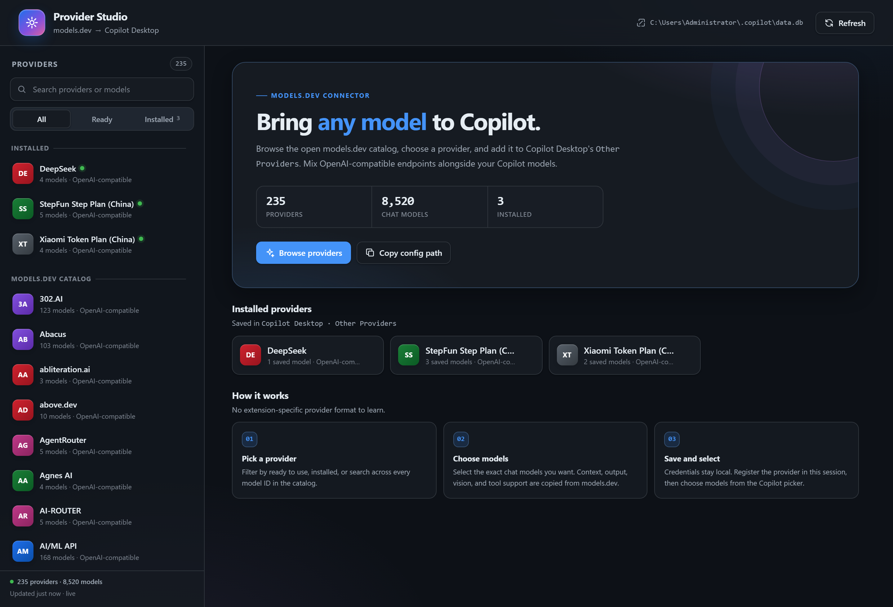
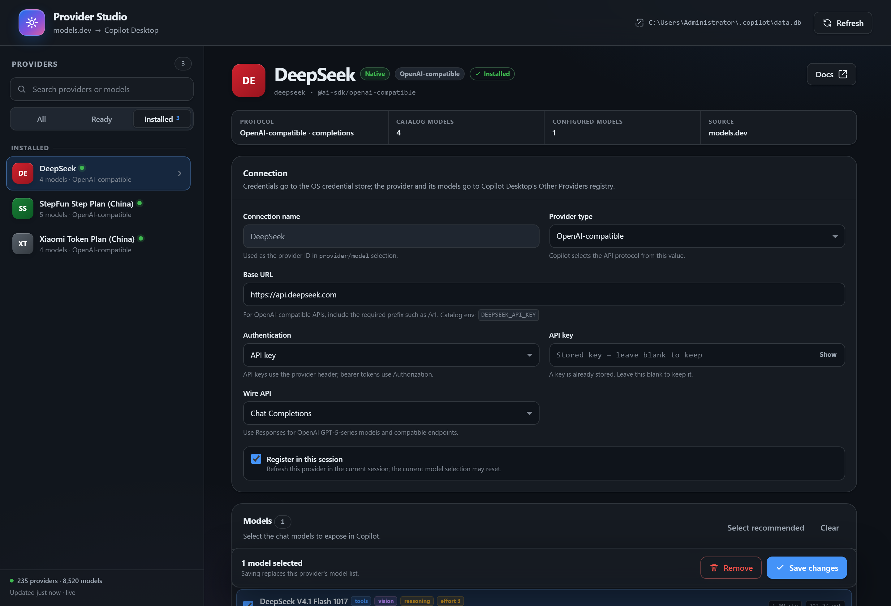
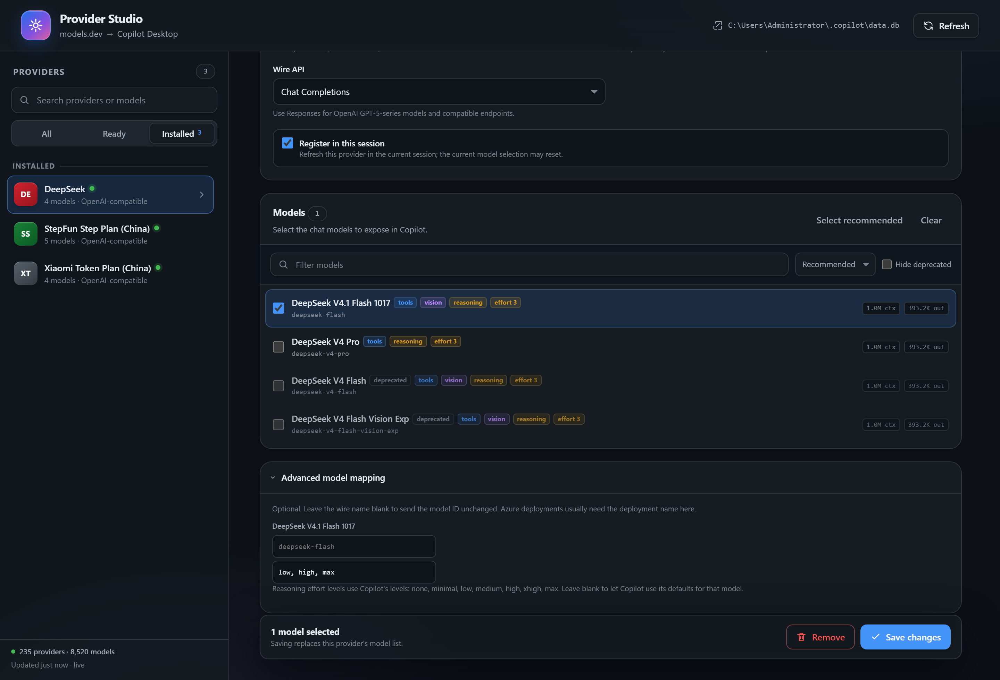

# 用于 Copilot Desktop 的 Models.dev Providers

[](LICENSE)

一个把 [models.dev](https://models.dev) 接入 **Copilot Desktop → Other Providers** 的 Canvas 扩展。

浏览 models.dev 的开放模型目录，选择供应商和聊天模型，填写密钥，供应商会写入 Copilot Desktop 自己的供应商注册表（与 *Other Providers* 设置使用同一处）。之后**所有会话都能直接使用**，并带有推理强度。

[English](README.md)



## 功能

- 浏览、搜索、筛选 models.dev 中**数百个供应商、数千个聊天模型**
- 写入 Copilot Desktop 自己的供应商注册表，因此会出现在所有会话的 **Other Providers** 中
- API Key / Bearer Token 存入系统凭据管理器，不写明文文件
- 把 models.dev 元数据映射为注册表字段：
  - 输入与输出 Token 上限
  - 工具调用与视觉支持
  - 推理强度等级（决定 Copilot 是否显示推理强度选项）
- 可在画布中编辑或删除已有的 App 供应商，包括模型列表和推理强度
- 可选：保存后立即注册到当前会话
- 画布接口和 Agent 都拿不到明文凭据

## 环境要求

- 支持 Canvas 扩展的 GitHub Copilot Desktop
- 能访问 `https://models.dev/api.json`
- 开发与测试需要 Node.js 20 或更高版本

## 安装

```bash
npm run install:extension
```

会把扩展复制到 `$COPILOT_HOME/extensions/models-dev-providers`；未设置 `COPILOT_HOME` 时为 `~/.copilot/extensions/models-dev-providers`。安装后请**新建一个 Copilot 会话**。也可以手动复制：

```powershell
Copy-Item -Recurse extensions\models-dev-providers "$HOME\.copilot\extensions\models-dev-providers"
```

## 使用

1. 打开 **Models.dev Providers** 画布
2. 在左侧选择供应商，或直接搜索模型
3. 勾选要使用的聊天模型
4. 填写：
   - **供应商名称**：在 Copilot Desktop 中显示的名称
   - **Base URL**：供应商的 HTTP(S) 地址
   - **认证方式**：API Key、Bearer Token 或无需认证
   - **Wire API**：Chat Completions 或 Responses
5. 保留 **Register in this session** 可立即在当前会话使用
6. 点击 **Add provider**，然后在 Copilot 模型选择器中选择该模型



### 修改与删除

选择已安装的供应商即可修改凭据或模型选择。取消勾选某个模型后保存即可移除；删除供应商会同时删除注册表记录和已保存的凭据。

## 推理强度

当模型的 `provider_models.supported_reasoning_efforts` 有等级列表时，Copilot Desktop 才会显示推理强度选项，例如：

```json
["low", "medium", "high"]
```



- models.dev 提供 `effort` 类型时，直接使用其等级列表
- 只提供推理开关的模型，默认使用 `["low", "medium", "high"]`
- 可在 **Advanced model mapping** 中逐模型修改
- Copilot 支持的等级：`none`、`minimal`、`low`、`medium`、`high`、`xhigh`、`max`。只填写模型实际支持的等级

## 数据存放位置

| 数据 | 位置 |
|---|---|
| 供应商与模型 | `~/.copilot/data.db` → `model_providers`、`provider_models` |
| API Key / Bearer Token | 系统凭据管理器：`byok:<provider-id>:apiKey` / `byok:<provider-id>:bearerToken` |
| models.dev 缓存 | `~/.copilot/plugin-data/models-dev-providers/catalog.json` |
| `data.db` 一次性备份 | `~/.copilot/plugin-data/models-dev-providers/backups/` |

`$COPILOT_HOME` 可覆盖 `~/.copilot`。

## models.dev 字段对应关系

`provider_models`：

| models.dev 数据 | 字段 |
|---|---|
| 模型 `name` | `display_name` |
| 模型 ID | `model_id` |
| wire model 覆盖 | `wire_model` |
| `limit.input`（或 context 减 output） | `max_prompt_tokens` |
| `limit.output` | `max_output_tokens` |
| `reasoning_options` | `supported_reasoning_efforts` |
| 是否支持图片输入 | `supports_vision` |

`model_providers.settings_json`：

| models.dev 数据 | 字段 |
|---|---|
| `api` 或已知兼容地址 | `baseUrl` |
| Responses / Chat Completions | `wireApi` |
| 认证方式 | `authKind` |

只列出文本输出的聊天模型；图像、向量、语音、视频、重排、实时模型会被排除。

非 OpenAI 兼容的供应商标记为 **Experimental**；Copilot Desktop 的 Other Providers 目前面向 OpenAI 兼容接口。

## 隐私与安全

- Canvas 服务器只监听 `127.0.0.1`
- 每个 Canvas 实例使用随机 URL Token
- 请求必须匹配 `Host`，带 `Origin` 时必须同源，并提供 Token
- 页面使用严格 CSP，无内联脚本和样式
- 画布接口与 Agent 动作不会返回 API Key、Bearer Token 或请求头
- 错误信息会脱敏已知凭据
- 首次写入注册表前会备份一次 `data.db`

Agent 可用动作：

- `search_catalog` — 搜索 models.dev 元数据
- `list_configured` — 列出 Other Providers（不含凭据）
- `list_session_models` — 列出当前会话已注册的模型 ID

Agent 无法通过上述动作添加供应商或读取凭据。

## 开发

无运行时依赖。

```bash
npm test       # 单元测试与 HTTP 集成测试
npm run check  # 语法检查
```

### 目录结构

```text
extensions/models-dev-providers/
├── extension.mjs          # Canvas 声明、Agent 动作、服务器生命周期
├── lib/
│   ├── app-registry.mjs   # data.db 注册表 + 系统凭据管理器
│   ├── catalog.mjs        # models.dev 拉取、缓存、分类、映射
│   ├── config.mjs         # 选择校验与模型映射
│   ├── live.mjs           # 当前会话的尽力实时注册
│   ├── server.mjs         # 本机 HTTP API 与静态资源
│   └── util.mjs           # URL、Token 上限、原子写入等工具
├── public/                # 画布前端（HTML、CSS、JS）
└── test/                  # node:test 测试
```

## 常见问题

**画布没有出现** — 安装后需要新建 Copilot 会话，扩展在会话启动时加载。

**提示供应商注册表不可用** — 找不到 Copilot Desktop 的 `data.db`。先打开一次 Copilot Desktop，再重新打开画布。

**无法访问 models.dev** — 会使用本地缓存；可点击 **Retry** 重试或检查网络。

**没有显示推理强度** — 重新打开该供应商，检查 **Advanced model mapping**。模型需要 `supported_reasoning_efforts`，只有布尔标记不会启用该选项。保存后重新打开模型选择器。

**模型没有出现** — 保留 **Register in this session**，或新建会话让 Copilot Desktop 重新加载注册表。

## 许可证

MIT，见 [LICENSE](LICENSE)。
